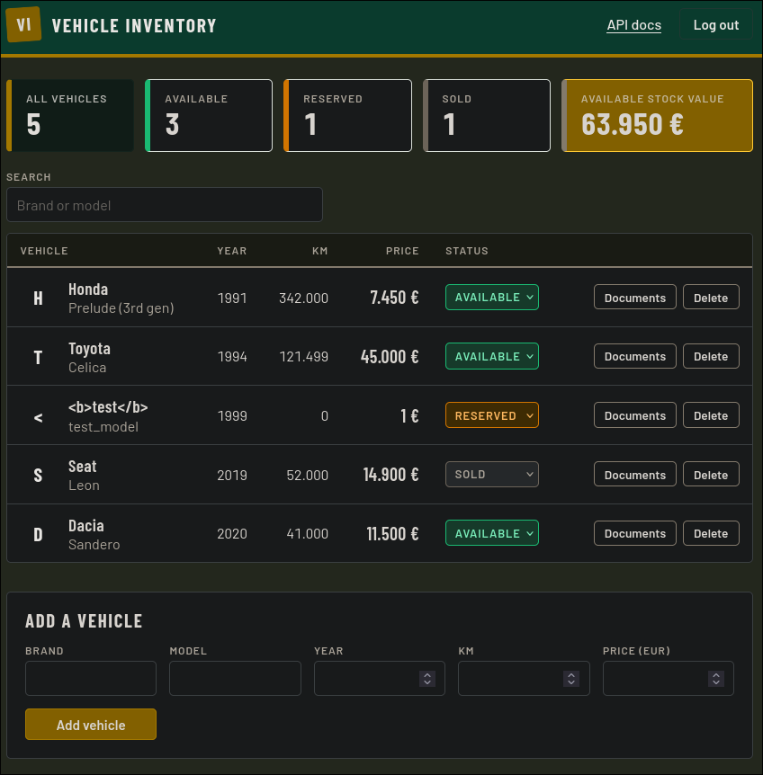
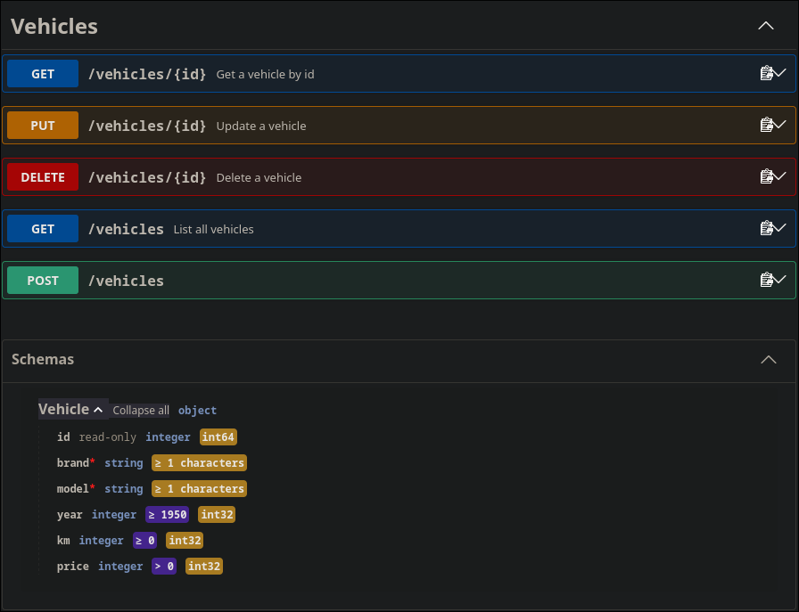
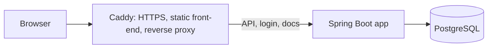

# Vehicle Inventory API


A REST API and a small web interface for managing a used-car dealer's vehicle inventory and each vehicle's document checklist. It's a learning project that models the kind of data I handle at work (vehicle listings and documentation), using sample data only.



## Features

- Vehicles with a status (`AVAILABLE`, `RESERVED`, `SOLD`), filtering by status, input validation and consistent error responses (RFC 9457).
- A document checklist for each vehicle (technical sheet, registration permit, ITV certificate, sales contract), with a status and an expiry date. The vehicle list shows how many documents have been received.
- Login with Spring Security, CSRF protection and a limit on failed login attempts.
- A web interface in plain HTML, CSS and JavaScript: stock counts by status that double as filters, search, sortable columns and a document dialog.
- Database migrations with Flyway, API documentation with Swagger UI, and tests that run in CI.
- A Docker Compose stack with Caddy as reverse proxy (automatic HTTPS in production) and a backup script.

## Tech stack

- Java 21, Spring Boot 4 (Spring Web, Spring Data JPA, Spring Security, Bean Validation)
- PostgreSQL 17 with Flyway migrations
- Maven
- Docker and Docker Compose, Caddy as reverse proxy and static file server
- springdoc-openapi (Swagger UI) for API documentation
- JUnit 5, Mockito and MockMvc (with Spring Security Test) for tests
- GitHub Actions for CI

## Run it

Requirements: Docker with the Compose plugin.

```bash
git clone https://github.com/rszabadi/Vehicle-inventory-API.git
cd Vehicle-inventory-API
cp .env.example .env
nano .env        # set DB_PASSWORD and APP_ADMIN_PASSWORD (see below)
docker compose up -d --build
```

Wait a few seconds for the app to start, then open `https://localhost:8443` and log in with `APP_ADMIN_USER` and `APP_ADMIN_PASSWORD` from your `.env`. Caddy uses a self-signed certificate locally, so your browser will show a warning that you have to accept.

Stop it with `docker compose down`. The database data is kept in a Docker volume (`docker compose down -v` deletes it).

### Configuration

All settings come from the `.env` file, which is never committed.

| Variable | Purpose |
|---|---|
| `DB_NAME`, `DB_USER`, `DB_PASSWORD` | PostgreSQL database and credentials |
| `APP_ADMIN_USER` | Username of the admin login (default `admin`) |
| `APP_ADMIN_PASSWORD` | Password of the admin login: at least 12 characters, otherwise nobody can log in |

Generate a strong password with `openssl rand -base64 18`.

## Development

Run only the database in Docker and start the app from your IDE:

```bash
docker compose up -d db
```

The app then listens on `http://localhost:8080`. The web interface is served by Caddy, so it needs the full Docker stack. From an IDE you can use the API and Swagger UI.

## API

Everything except `/login` needs a login session. Changes (POST, PUT, DELETE) also need the `X-XSRF-TOKEN` header, with the value of the `XSRF-TOKEN` cookie; the web interface does this automatically. Requests without a session get `401`, and changes without the token get `403`.

### Vehicles

| Method | Path | Description |
|---|---|---|
| GET | `/vehicles` | List vehicles (optional `?status=AVAILABLE`, `RESERVED` or `SOLD`) |
| GET | `/vehicles/{id}` | Get one vehicle (404 if missing) |
| POST | `/vehicles` | Create a vehicle (400 if invalid) |
| PUT | `/vehicles/{id}` | Update a vehicle |
| DELETE | `/vehicles/{id}` | Delete a vehicle |

Example request body for `POST /vehicles`:

```json
{ "brand": "Toyota", "model": "Celica", "year": 1994, "km": 41000, "price": 11500, "status": "AVAILABLE" }
```

Example response:

```json
{
  "id": 1,
  "brand": "Toyota",
  "model": "Celica",
  "year": 1994,
  "km": 41000,
  "price": 11500,
  "status": "AVAILABLE",
  "documentsReceived": 2,
  "documentsTotal": 4
}
```

`status` is optional (default `AVAILABLE`), and fields the API doesn't expect, such as `id`, are ignored on create.

### Documents

Each vehicle has a checklist of documents. A document has a type, a status (`PENDING` or `RECEIVED`) and an optional expiry date.

| Method | Path | Description |
|---|---|---|
| GET | `/vehicles/{id}/documents` | List a vehicle's documents |
| POST | `/vehicles/{id}/documents` | Add a document (409 if the type already exists) |
| PUT | `/vehicles/{id}/documents/{docId}` | Update status and expiry date |
| DELETE | `/vehicles/{id}/documents/{docId}` | Delete a document |

Example request body for `POST /vehicles/1/documents`:

```json
{ "type": "ITV_CERTIFICATE", "expiresOn": "2027-03-15" }
```

Document types: `TECHNICAL_SHEET`, `REGISTRATION_PERMIT`, `ITV_CERTIFICATE`, `SALES_CONTRACT`.

### Errors

Errors use the standard problem format (RFC 9457). Validation errors list the invalid fields:

```json
{
  "title": "Bad Request",
  "status": 400,
  "detail": "Validation failed",
  "instance": "/vehicles",
  "errors": { "brand": "must not be blank", "km": "must be greater than or equal to 0" }
}
```

### API documentation

Interactive documentation (Swagger UI, login required) is available at `/swagger-ui/index.html`: `https://localhost:8443/swagger-ui/index.html` with Docker, or `http://localhost:8080/swagger-ui/index.html` from an IDE.



## Security

- One admin user, configured through environment variables. The password is hashed with BCrypt in memory, and it never appears in the repository.
- Session login with a cookie that is `HttpOnly` and `SameSite=Lax`, and `Secure` when served over HTTPS.
- CSRF protection on all changes.
- Failed logins are limited: five failures lock an address out for 15 minutes. The counters live in memory, so a restart resets them.
- Swagger UI and the API documentation are behind the login.
- The static pages are served with a Content Security Policy.
- Only Caddy is exposed. The database port is bound to localhost, and the app container runs as a non-root user.
- This is a single-user setup for a demo. A user table with roles would be the next step for a multi-user system.

## Tests

```bash
docker compose up -d db
./mvnw test
```

Unit tests, API tests with MockMvc, and security tests (login, CSRF, redirects, attempt limit). The tests need the database running locally. CI runs them on every push, against its own PostgreSQL container.

## Backups

```bash
./scripts/backup.sh
```

Writes a compressed SQL dump to `backups/` and deletes dumps older than 14 days. To restore, pipe a dump into `psql` on an **empty** database:

```bash
gunzip -c backups/<file>.sql.gz | docker compose exec -T db sh -c 'psql -U "$POSTGRES_USER" -d "$POSTGRES_DB"'
```

## Architecture



Caddy serves the web interface and forwards the API, login and documentation paths to the app. The app and the database are only reachable inside the Docker network (and the database on localhost for development).

```
src/main/java/                     controllers, entities, DTOs, security configuration
src/main/resources/db/migration/   Flyway migrations
src/test/java/                     unit, API and security tests
frontend/                          web interface (HTML, CSS, JavaScript, fonts)
scripts/backup.sh                  database backup
Caddyfile, Caddyfile.prod          reverse proxy configuration (local and production)
compose.yaml, compose.prod.yaml    Docker Compose (base and production override)
docs/                              screenshots
```

## Deployment

The stack runs on a Linux machine with Docker Compose behind Caddy, which obtains and renews HTTPS certificates automatically. Production adds an override file:

```bash
cp .env.example .env     # set DB_PASSWORD and a long random APP_ADMIN_PASSWORD
docker compose -f compose.yaml -f compose.prod.yaml up -d --build
```

`Caddyfile.prod` contains the domain names (here `vehicles.rmihai.com`), so change them for your own domain. The DNS records must point to the server, and ports 80 and 443 must be reachable for the certificates.

## Roadmap

- [x] CRUD endpoints with input validation
- [x] Vehicle status, request/response DTOs and consistent error responses
- [x] Vehicle document checklist
- [x] Docker Compose setup, database migrations (Flyway) and backups
- [x] Integration tests and CI with GitHub Actions
- [x] API documentation (Swagger UI)
- [x] Web interface served by Caddy
- [x] Login (Spring Security) with CSRF protection and attempt limit
- [x] Deployment with a reverse proxy and HTTPS (on my own machine for now)
- [ ] Scheduled backups and a copy on a second machine
- [ ] Dependency updates (Dependabot) and code scanning (CodeQL)
- [ ] Move to a dedicated Ubuntu server

## License and credits

MIT, see [LICENSE](LICENSE). Fonts: Barlow and Barlow Condensed (SIL Open Font License 1.1).
